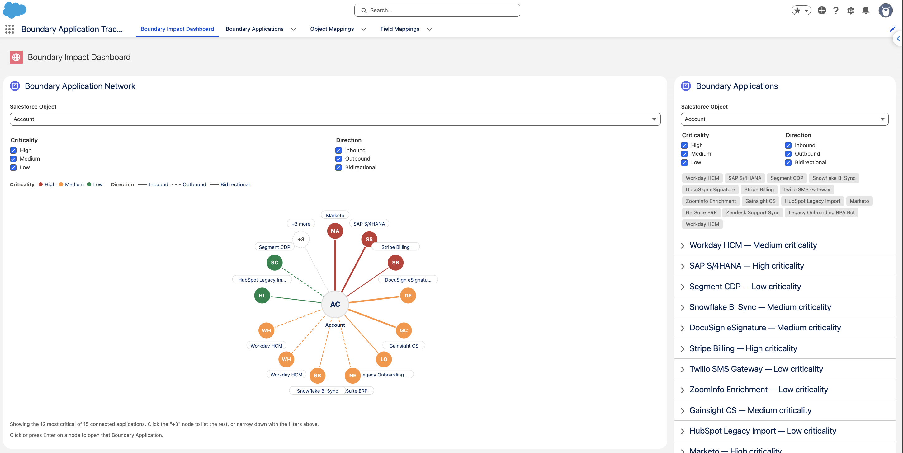
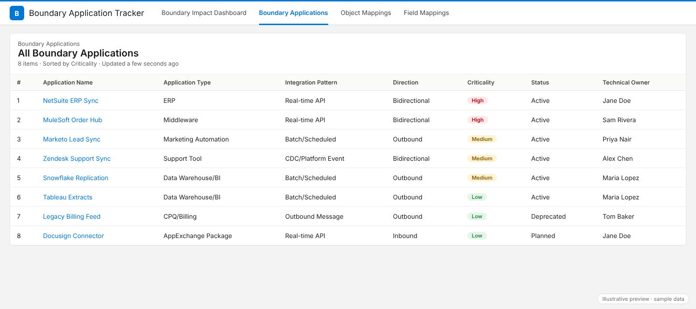
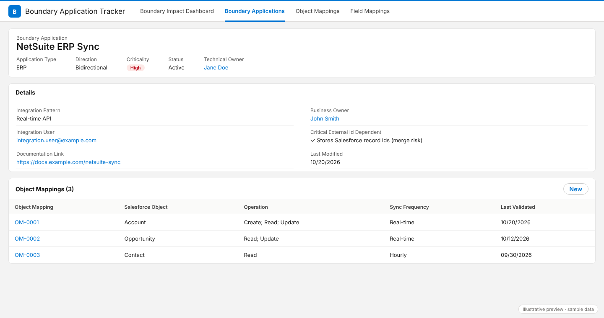
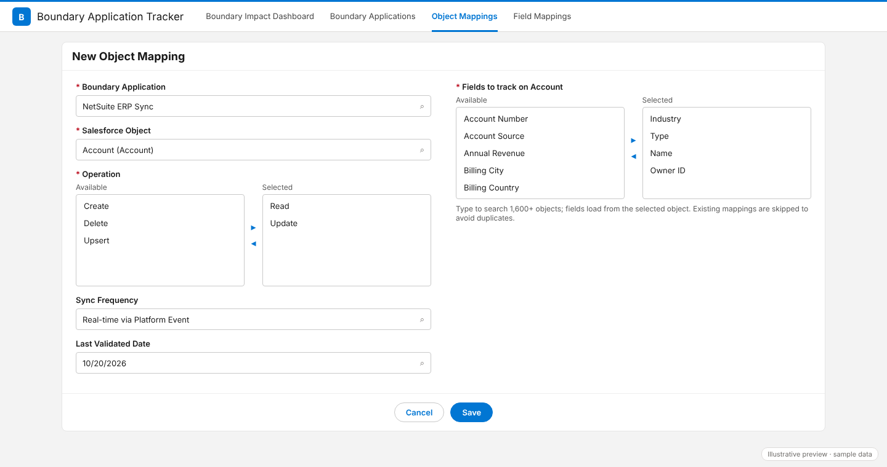
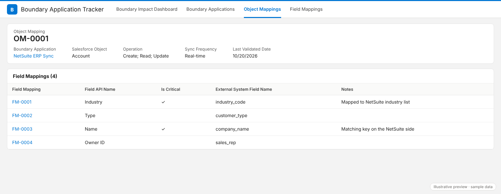
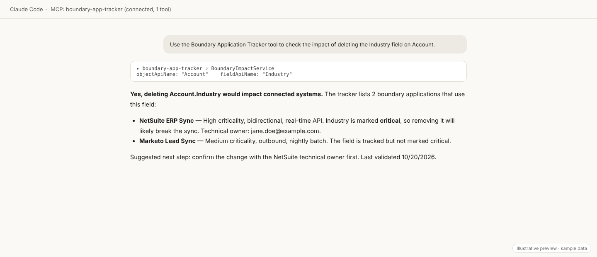
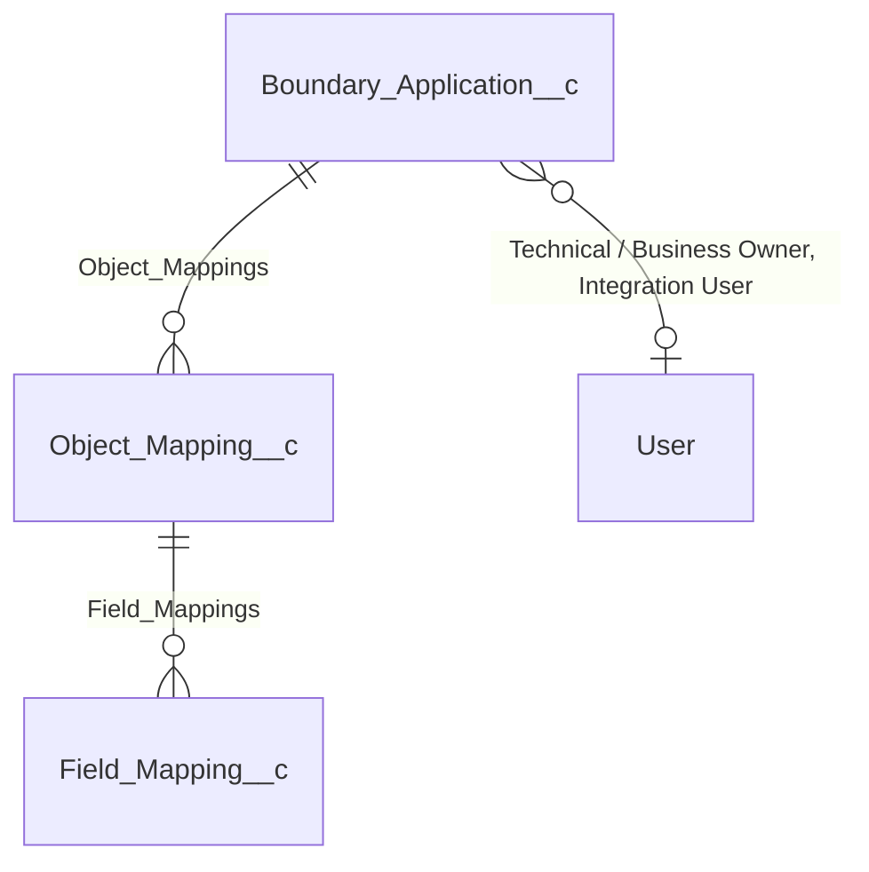

# Boundary Application Tracker

Know which external systems depend on a Salesforce object or field before you change it.


## Contents

- [The problem it solves](#the-problem-it-solves)
- [What it does](#what-it-does)
- [Screenshots](#screenshots)
- [Data model](#data-model)
- [How data entry works](#how-data-entry-works)
- [Impact checking](#impact-checking)
- [Asking Claude via the Salesforce Hosted MCP Server](#asking-claude-via-the-salesforce-hosted-mcp-server)
- [Architecture](#architecture)
- [Installation](#installation)
- [Manual setup steps](#manual-setup-steps)
- [Permission sets](#permission-sets)
- [Known issues](#known-issues)
- [Roadmap](#roadmap)
- [Follow along](#follow-along)
- [Contributing](#contributing)
- [License](#license)

## The problem it solves

Salesforce data rarely stays inside Salesforce. Middleware (MuleSoft, Informatica, Boomi), ERP systems, marketing automation, CPQ and billing tools, data warehouses and BI platforms, RPA bots and custom API consumers all read from or write to your objects and fields.

None of those dependencies are visible in Setup. Deleting a field, changing its type, deleting an object or merging Accounts can silently break an integration you didn't know existed. Some failures are immediate. Others go unnoticed until the next nightly batch runs.

Boundary Application Tracker gives you one place to record which external systems touch which objects and fields. Before you change anything, you can check what depends on it.

## What it does

- **Records connected applications.** Each external system is a *Boundary Application* with its type, integration pattern, data direction, criticality, status and owners.
- **Maps applications to objects and fields.** *Object Mappings* say which Salesforce objects an application touches and how (Create, Read, Update, Delete, Upsert), how often it syncs and when the mapping was last validated. *Field Mappings* list the specific fields and flag the critical ones.
- **Checks impact on demand.** The Boundary Impact Dashboard shows a network graph and a detail panel for any tracked object. The same check is available as a Flow/Agentforce invocable action and as an Apex REST endpoint.
- **Lets you ask Claude.** Through the Salesforce Hosted MCP Server, Claude (or Agentforce, or a Flow) can answer questions like *"What breaks if I delete `Account.Legacy_Id__c`?"* using the records you've entered.

> **Scope:** the tracker reports **known** impact only, based on the records your team has entered. It does not discover integrations, monitor schema changes, send alerts or block deployments. An empty result means "nothing recorded", not "nothing depends on this".

## Screenshots

> Screenshots are illustrative previews using sample data, not captures from a production org. Each file in [`docs/screenshots/`](docs/screenshots/) can be replaced with a real PNG of the same name.

**Boundary Impact Dashboard.** The network graph (left) puts the selected object at the center, with connected applications colored by criticality and edges styled by data direction. The impact panel (right) lists the same applications with owners, sync frequency and last-validated date.



**Boundary Applications list view.** The inventory of external systems connected to the org.



**Boundary Application record.** One external system with its Object Mappings related list.



**New Object Mapping.** Searchable object picker, Operation, Sync Frequency and bulk field selection on a single screen.



**Object Mapping record.** One object-level mapping with its Field Mappings related list.



**Claude answering an impact question.** Claude calls the *Check Boundary Application Impact* tool through the Salesforce Hosted MCP Server and summarizes the result.



## Data model

Three custom objects in a master-detail chain. Deleting a parent deletes its children.



Object API names and field API names are stored as **plain text**, not metadata references. This keeps the package portable across orgs and lets you track objects or fields that are not installed yet.

### `Boundary_Application__c` (Boundary Application)

An external system that sends data to or reads data from Salesforce. Sharing: Read/Write.

| Field | Type | Meaning |
|---|---|---|
| `Name` (Application Name) | Text | Name of the external system. |
| `Application_Type__c` | Picklist (required) | Middleware, ERP, Marketing Automation, CPQ/Billing, Data Warehouse/BI, Support Tool, AppExchange Package, RPA, Custom API Consumer. |
| `Integration_Pattern__c` | Picklist (required) | Real-time API, Batch/Scheduled, CDC/Platform Event, Outbound Message, Salesforce Connect. Real-time and CDC integrations tend to fail immediately; batch integrations may fail silently until their next run. |
| `Direction__c` | Picklist (required) | Inbound (writes into Salesforce), Outbound (reads out), Bidirectional. |
| `Criticality__c` | Picklist (required) | High, Medium, Low. High means revenue or compliance impact. |
| `Status__c` | Picklist (required) | Active, Deprecated, Planned. Only Active integrations have current-day impact. |
| `Critical_External_Id_Dependent__c` | Checkbox | The external system stores Salesforce record Ids. Merges invalidate the losing record's Id, so this flags the app as high-risk for merges. |
| `Technical_Owner__c` | Lookup (User) | Person who maintains the integration technically. |
| `Business_Owner__c` | Lookup (User) | Person accountable for the integration on the business side. |
| `Integration_User__c` | Lookup (User) | Salesforce user the system authenticates as, if it has one. |
| `Documentation_Link__c` | URL | Link to external docs (MuleSoft flow, Informatica mapping, API spec, wiki). |

### `Object_Mapping__c` (Object Mapping)

Which Salesforce object a Boundary Application touches, and how. Auto-number name `OM-{0000}`. Sharing: controlled by parent.

| Field | Type | Meaning |
|---|---|---|
| `Boundary_Application__c` | Master-Detail (Boundary Application) | The external system this mapping belongs to. |
| `Object_API_Name__c` | Text(255) (required) | API name of the Salesforce object, for example `Account` or `Invoice__c`. |
| `Operation__c` | Multi-select picklist (required) | Create, Read, Update, Delete, Upsert. |
| `Sync_Frequency__c` | Picklist | Real-time, Real-time via Platform Event, Near real-time (micro-batch), Every 5/15/30 minutes, Hourly, Every 4/6 hours, Nightly batch, Daily, Weekly, Monthly, Quarterly, On-demand / Manual, One-time historical import. |
| `Last_Validated_Date__c` | Date | When the owner last confirmed the mapping is accurate. Mappings older than six months should be re-verified. |

### `Field_Mapping__c` (Field Mapping)

A specific field that an Object Mapping depends on. Auto-number name `FM-{0000}`. Sharing: controlled by parent.

| Field | Type | Meaning |
|---|---|---|
| `Object_Mapping__c` | Master-Detail (Object Mapping) | The object-level mapping this field belongs to. |
| `Field_API_Name__c` | Text(255) (required) | API name of the Salesforce field, for example `Email` or `Legacy_Customer_Number__c`. |
| `Object_API_Name__c` | Formula (Text) | Copied from the parent Object Mapping for list views and layouts. |
| `Is_Critical__c` | Checkbox | Deleting this field or changing its type would break the integration. |
| `External_System_Field_Name__c` | Text(255) | What the field is called in the external system. For readers only. |
| `Notes__c` | Long Text Area | Transformation logic, quirks, edge cases. |

## How data entry works

**Schema-driven pickers instead of typed API names.** On the New and Edit screens for Object Mapping, you choose the object from a searchable list built from the org's schema (`SchemaDiscoveryService.getTrackableObjects`). The list includes every object you can access, excluding hidden/deprecated objects and custom settings. Fields come from a describe of the chosen object. You never type an API name, so typos can't create mappings that silently match nothing.

**One New/Edit screen on Object Mapping.** The `ObjectMappingNewOverride` Aura component is the New and Edit action override for Object Mapping. It hosts the `objectMappingCreator` LWC, which handles both modes:

- **New, launched from a Boundary Application's related list:** the parent application is pre-filled and locked.
- **New, launched from the Object Mapping tab:** you pick the Boundary Application from a searchable list.
- **Edit:** the Boundary Application and object are read-only, because the master-detail parent can't be reparented and changing the object would invalidate existing field mappings. You can change Operation, Sync Frequency, Last Validated Date and the field selection.

**Bulk field selection.** A dual list box shows every accessible field on the chosen object. On save, one Field Mapping is created per selected field. In Edit mode, newly selected fields are created and deselected fields are deleted. The standard New and Edit actions on Field Mapping are left as defaults, so you can still open an individual Field Mapping to set **Is Critical**, the external field name and notes.

> Field Mappings created from this screen are saved with **Is Critical** unchecked. Open each Field Mapping that would break the integration and check **Is Critical**.

**Duplicate protection.**

- An Object Mapping is a duplicate if another record has the same Boundary Application, object **and** Operation value. Operation is part of the identity on purpose: one application can legitimately have separate Read and Upsert mappings on the same object.
- A Field Mapping is rejected if the same field is already mapped under the same Object Mapping.

All writes run in user mode (`AccessLevel.USER_MODE` / `WITH USER_MODE`), so the user's own object, field and sharing permissions apply.

## Impact checking

There are three entry points. All of them call the same shared query class, `BoundaryImpactQueryService.findBoundaryMappings(objectApiName, fieldApiName)`, so they always agree on what counts as "connected".

- **Object-level check** (no field): returns every Object Mapping for the object.
- **Field-level check:** returns only Object Mappings that have a Field Mapping for that field, one row per matching Field Mapping, including the **Is Critical** flag.

| Entry point | Class | Used by | Returns |
|---|---|---|---|
| Invocable action **Check Boundary Application Impact** | `BoundaryImpactService` (global) | Flow, Agentforce, Salesforce Hosted MCP Server | `hasKnownBoundaryApplications`, a ready-to-read `summary`, and a flat list of applications with criticality, direction, pattern, status, owners (name and email), sync frequency, last-validated date, External Id dependency and Is Critical Field. |
| Apex REST resource | `BoundaryImpactMcpResource` | Any authenticated HTTP client: `GET /services/apexrest/boundaryImpact?objectApiName=Account&fieldApiName=Email` | Flat, conversational JSON: `hasKnownImpact`, `connectedApplications`, `summary`. Validates the object and field against the schema and returns a 400 with a readable message for unknown names. |
| LWC controller | `BoundaryImpactController` | `boundaryImpactPanel`, `boundaryNetworkGraph`, `boundaryImpactDashboard` | `hasKnownBoundaryApplications` and application details for display. Also lists the distinct tracked objects for the object picker. |

### The three results

| Result | Meaning |
|---|---|
| **Impact found** | One or more applications are recorded against the object (or the field). The REST resource leads its summary with high-criticality applications. |
| **Object tracked, field not tracked** | The object has Object Mappings, but none of them record a dependency on this field. That might mean the field is safe to change, or that nobody has recorded field-level detail yet. Check with the application owners. |
| **Object not tracked** | No Object Mappings exist for the object at all, so there is no field-level data either. |

The REST resource reports all three results with a distinct summary for each. The invocable action and the LWC controller report "found" versus "nothing recorded for this request" (`hasKnownBoundaryApplications = false`). They do not separately tell you whether the object itself is tracked. To check that with them, run an object-level check.

## Asking Claude via the Salesforce Hosted MCP Server

Salesforce Hosted MCP Servers (beta) let you expose selected Salesforce capabilities as MCP tools to external AI clients. This project exposes the **Check Boundary Application Impact** invocable action as a tool. Claude can then answer impact questions against your live tracker data.

**How a request flows**

1. You ask Claude something like *"Use the Check Boundary Application Impact tool: what breaks if I delete the Email field on Contact?"*
2. Claude calls the tool on your org's MCP server with `objectApiName = Contact` and `fieldApiName = Email`.
3. Salesforce runs `BoundaryImpactService` **as you**, the authenticated user, so your field-level security and sharing apply. There is no shared integration user.
4. Claude summarizes the returned applications, criticality, owners and the Is Critical flag.

**Things that matter**

- **The Apex action must be `global`.** `BoundaryImpactService`, along with its `Request`, `Response` and `BoundaryApplicationImpact` inner classes, is declared `global` so the Hosted MCP Server can expose the invocable method as a tool. If you fork the class, keep it `global`.
- **Use an External Client App, not a Connected App.** The OAuth client for the MCP server is an External Client App (included in this source as `Boundary_Application_Tracker_MCP_Client`).
- **The tool description is limited to 250 characters.** The invocable method's own description is longer than that, so enter a shorter one when you add the tool to the MCP server (see [Manual setup steps](#manual-setup-steps)).
- **Name the tool in your prompt.** Claude picks tools far more reliably when you say *"use the Check Boundary Application Impact tool"* than when you only describe the question.

## Architecture

All metadata lives in `force-app/main/default`.

### Apex classes

| Class | Purpose |
|---|---|
| `BoundaryImpactQueryService` | Shared query logic: finds the Object and Field Mappings connecting applications to an object or field, in user mode. |
| `BoundaryImpactService` | `global` invocable action **Check Boundary Application Impact** for Flow, Agentforce and the Hosted MCP Server. |
| `BoundaryImpactMcpResource` | `global` Apex REST resource at `/boundaryImpact/*` that returns flat, conversational JSON with three distinct results. |
| `BoundaryImpactController` | `@AuraEnabled` controller for the impact panel, network graph and dashboard. Also lists tracked objects for the picker. |
| `SchemaDiscoveryService` | Read-only, cacheable schema lookups that power the object and field pickers. |
| `ObjectMappingCreatorController` | Create, update and load-for-edit for Object Mappings, plus the Boundary Application picker and duplicate check. |
| `FieldMappingCreatorController` | Bulk create (with duplicate check) and bulk delete of Field Mappings. |

### Lightning Web Components

| Component | Exposed | Purpose |
|---|---|---|
| `boundaryImpactDashboard` | App, Record, Home pages | Lays out the network graph (3/4 width) and impact panel (1/4 width) side by side. Stacks them on narrow screens. |
| `boundaryNetworkGraph` | App, Record, Home pages, Flow screens | SVG diagram with the object at the center and connected applications around it. Nodes are colored by criticality and edges are styled by direction. Shows up to 12 nodes and puts the rest under a "+N" overflow node. Has criticality and direction filters. Click a node to open the record. |
| `boundaryImpactPanel` | App, Record, Home pages, Flow screens, Utility bar | Criticality-colored chips and expandable details for each connected application: direction, pattern, sync frequency, owners, last validated, Is Critical. Includes filters and a "Track a new Boundary Application" button in the empty state. |
| `objectMappingCreator` | Not exposed (hosted by the Aura override) | The New/Edit screen for Object Mapping with schema pickers and bulk field selection. |
| `schemaOptionPicker` | Not exposed (child component) | Searchable, keyboard-navigable combobox used for the application, object and field pickers. |

### Aura

| Bundle | Purpose |
|---|---|
| `ObjectMappingNewOverride` | `lightning:actionOverride` wrapper used as the New and Edit override on Object Mapping. It reads the record Id and related-list default values and passes them to `objectMappingCreator`. Action overrides require an Aura top-level component. |

### Other metadata

| Type | Name | Purpose |
|---|---|---|
| Custom Application | `Boundary_Application_Tracker` | Lightning app with the Boundary Impact Dashboard, Boundary Applications, Object Mappings and Field Mappings tabs. |
| FlexiPage | `Boundary_Application_Impact_Dashboard` | App page that hosts `boundaryImpactDashboard`, with `Account` as the default object. |
| Tabs | `Boundary_Impact_Dashboard`, `Boundary_Application__c`, `Object_Mapping__c`, `Field_Mapping__c` | Navigation for the app. |
| Layouts | Object Mapping Layout, Field Mapping Layout | Record page layouts. |
| List views | `All` (Boundary Applications), `All_Objects` (Object Mappings), `All_Fields_Mapping` (Field Mappings) | Default list views. |
| Permission sets | `Boundary_Applications_Admin`, `Boundary_Application_User` | See [Permission sets](#permission-sets). |
| External Client App | `Boundary_Application_Tracker_MCP_Client` (plus its OAuth settings and policy files) | OAuth client for AI assistants connecting through the Hosted MCP Server. PKCE required, no consumer secret, self-authorized users, scopes `MCP` and `RefreshToken`. |
| MCP Server Definition | `BoundaryApplicationTrackerMCP` | Label and description for the custom MCP server. The tool itself is added in Setup. |

## Installation

### Prerequisites

- [Salesforce CLI](https://developer.salesforce.com/tools/salesforcecli) (`sf`).
- A Developer Edition org, sandbox or scratch org with Lightning Experience. To use the Claude integration, the org needs access to the Salesforce Hosted MCP Server beta.
- Permission to deploy metadata (Modify All Data or Customize Application).

> There are no Apex test classes yet. Deploys to production require 75% Apex test coverage and will fail. Deploy to a Developer Edition org, sandbox or scratch org.

### Deploy from source

```bash
git clone https://github.com/batra-kapil/Boundary-Apps-Tracker.git
cd Boundary-Apps-Tracker

# Authorize your org (opens a browser)
sf org login web --alias my-org

# Deploy everything in force-app
sf project deploy start --source-dir force-app --target-org my-org
```

If your org doesn't have the Hosted MCP Server beta, or your user can't deploy External Client Apps, deploy without those components and set them up by hand later:

```bash
sf project deploy start --target-org my-org \
  --source-dir force-app/main/default/applications \
  --source-dir force-app/main/default/aura \
  --source-dir force-app/main/default/classes \
  --source-dir force-app/main/default/flexipages \
  --source-dir force-app/main/default/layouts \
  --source-dir force-app/main/default/lwc \
  --source-dir force-app/main/default/objects \
  --source-dir force-app/main/default/permissionsets \
  --source-dir force-app/main/default/tabs
```

### Assign permission sets

```bash
# People who maintain the inventory
sf org assign permset --name Boundary_Applications_Admin --target-org my-org

# Read-only users (add --on-behalf-of <username> to assign to someone else)
sf org assign permset --name Boundary_Application_User --target-org my-org
```

### Sample data

No sample-data script is included yet. Open the **Boundary Application Tracker** app, create a Boundary Application, then add Object Mappings from its related list.

### Package version

Package version coming soon. Deploy from source for now.

## Manual setup steps

These steps don't deploy reliably through metadata. Do them once per org. Replace every `<PLACEHOLDER>` with your own value.

### 1. Confirm the New and Edit overrides on Object Mapping

The object metadata already sets `ObjectMappingNewOverride` as the New and Edit override. After deploying, confirm it in **Setup → Object Manager → Object Mapping → Buttons, Links, and Actions**. If **New** or **Edit** still shows the standard page, edit the action, choose **Lightning component** and select `c:ObjectMappingNewOverride`.

### 2. Create and activate the custom MCP server

1. In **Setup**, search for **MCP Servers** (beta).
2. Open the **Boundary Application Tracker MCP** server if the deploy created it. Otherwise create a new custom server with that name.
3. Add a tool of type **Apex action** and select **Check Boundary Application Impact** (`BoundaryImpactService`).
4. Enter a tool description of 250 characters or fewer. For example (228 characters):

   ```text
   Checks which external systems (Boundary Applications) depend on a Salesforce object or field. Call before deleting or changing a field, deleting an object, or merging records. objectApiName is required; fieldApiName is optional.
   ```

5. Save and **activate** the server. Copy its server URL. That is `<YOUR_MCP_SERVER_URL>` below.

### 3. Create or complete the External Client App

The source includes `Boundary_Application_Tracker_MCP_Client`. If it deployed, open it in **Setup → External Client App Manager** and check the settings below. If it didn't deploy, create a new External Client App with these settings. Use an External Client App, not a Connected App.

| Setting | Value |
|---|---|
| Distribution state | Local |
| Contact email | `<YOUR_ADMIN_EMAIL>` |
| Enable OAuth | Yes |
| Callback URLs | `https://claude.ai/api/mcp/auth_callback` (claude.ai and Claude Desktop connectors)<br>`http://localhost:38000/callback` (Claude Code) |
| OAuth scopes | Access Salesforce hosted MCP servers (`MCP`) and Perform requests at any time (`RefreshToken`) |
| Require PKCE | Yes |
| Require secret for Web Server Flow | No (no consumer secret) |
| Client credentials, device and JWT flows | Off |
| Permitted users (policies) | All users may self-authorize |

> The deployed metadata contains only the claude.ai callback URL. Add `http://localhost:38000/callback` by hand if you'll use Claude Code.

After saving, open **Settings → OAuth Settings → Consumer Key and Secret** and copy the **Consumer Key**. That is `<YOUR_CONSUMER_KEY>`. Treat it as private and never commit it.

### 4. Connect Claude

Each user signs in with their own Salesforce credentials the first time they connect.

**claude.ai or Claude Desktop:** go to **Settings → Connectors → Add custom connector**. Enter `<YOUR_MCP_SERVER_URL>`, and under advanced settings enter `<YOUR_CONSUMER_KEY>` as the OAuth Client ID. Leave the client secret empty.

**Claude Code:**

```bash
claude mcp add --transport http \
  --client-id <YOUR_CONSUMER_KEY> \
  --callback-port 38000 \
  boundary-app-tracker <YOUR_MCP_SERVER_URL>
```

Then run `/mcp` inside Claude Code to complete the Salesforce login.

**Try it:**

```text
Use the Check Boundary Application Impact tool to tell me what breaks if I delete the Email field on Contact.
```

## Permission sets

| Permission set | Grants | Assign to |
|---|---|---|
| **Boundary Applications Admin** (`Boundary_Applications_Admin`) | Create, read, edit and delete on all three objects. Edit access on all custom fields (the formula field is read-only). Access to all seven Apex classes, the app and the four tabs. No View All or Modify All. | Admins and integration owners who maintain the inventory. Required for the New/Edit Object Mapping screen. |
| **Boundary Application User** (`Boundary_Application_User`) | Read-only access to all three objects and their fields. Access to `BoundaryImpactController`, `BoundaryImpactService`, `BoundaryImpactMcpResource` and `BoundaryImpactQueryService`, the app and the four tabs. | Admins, developers and release managers who check impact (in the dashboard, Flow, Agentforce or Claude) but don't edit the inventory. |

Impact checks run in user mode, so a user without read access to these objects gets an error or empty results, not someone else's data.

## Known issues

- **Salesforce Hosted MCP Servers are in beta.** Setup screens, behavior and availability may change.
- **The claude.ai custom connector has had OAuth and tool-invocation bugs** with Salesforce Hosted MCP: failed sign-ins, or the tool not being called. Claude Code (`claude mcp add` above) has been the more reliable fallback.
- **The MCP server definition may not persist through a metadata deploy.** `BoundaryApplicationTrackerMCP` contains only a label and description, and the tool configuration isn't in source. Expect to add the tool and activate the server in Setup (step 2 above).
- **No Apex tests yet,** so the source can't be deployed to production. See [Roadmap](#roadmap).

## Roadmap

These are ideas only. **None of them is built.**

- **Bulk setup wizard** for entering many applications and mappings at once.
- **Agentforce topic wiring** so an Agentforce agent calls the impact action automatically before suggesting metadata changes.
- **JIRA integration** to attach impact results to change tickets.
- **Apex test coverage** for all classes, which production deploys and a packaged release require.

## Follow along

If you find this project useful, **[subscribe to SF Bolt on YouTube](https://youtube.com/SalesforceBolt)** for content on AI, Agentforce, LWC and more.

## Contributing

Issues and pull requests are welcome.

1. Fork the repo and create a branch.
2. Deploy to a scratch org or Developer Edition org and test your change there.
3. Run `npm install` once, then `npm run lint` and `npm run prettier:verify` before committing. The Husky pre-commit hook runs Prettier, ESLint and LWC Jest on staged files.
4. Don't commit org-specific values: usernames, org Ids, My Domain URLs, consumer keys or real people's data.
5. Open a pull request that explains what changed and how you tested it.

## License

Released under the [MIT License](LICENSE).
